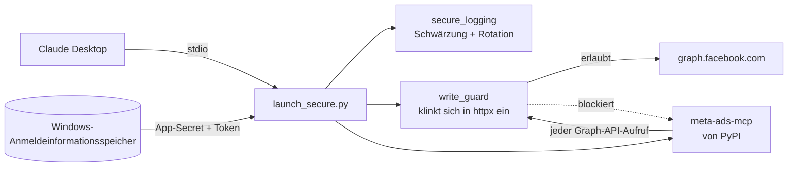
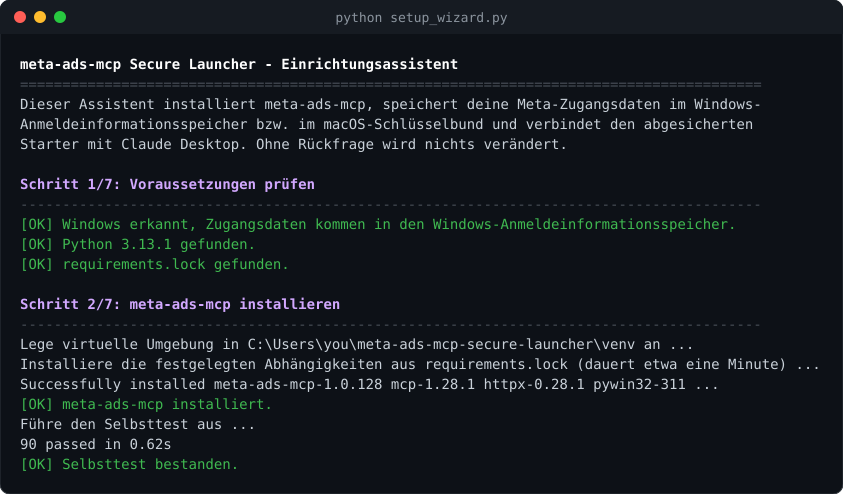
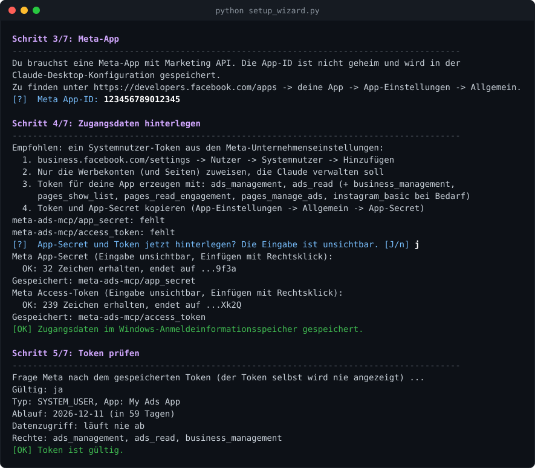
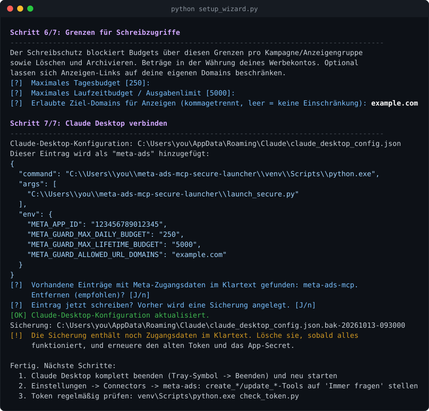

# meta-ads-mcp Secure Launcher

[English](README.md) · **Deutsch**

Ein abgesicherter Starter für [`meta-ads-mcp`](https://github.com/pipeboard-co/meta-ads-mcp) unter Windows. Damit arbeitet Claude Desktop mit deinen Meta-Werbekonten (Facebook/Instagram), **ohne Zugangsdaten im Klartext in Konfigurationsdateien, ohne Tokens in Logdateien und mit einer lokalen Sicherung für Schreibzugriffe**.

Der Starter verändert `meta-ads-mcp` nicht. Er installiert das Originalpaket von PyPI, startet es über eine kleine Hülle und ergänzt die unten beschriebenen Schutzmaßnahmen. Ein zweisprachiger Einrichtungsassistent (Deutsch/Englisch) führt Schritt für Schritt durch die Einrichtung.

> [!NOTE]
> Dies ist ein unabhängiges Community-Projekt, ohne Verbindung zu Meta, Pipeboard oder Anthropic.

---

## Inhalt

- [Warum?](#warum)
- [Funktionen](#funktionen)
- [Funktionsweise](#funktionsweise)
- [Voraussetzungen](#voraussetzungen)
- [Schnellstart mit dem Einrichtungsassistenten](#schnellstart-mit-dem-einrichtungsassistenten)
- [Manuelle Einrichtung](#manuelle-einrichtung)
- [Konfiguration](#konfiguration)
- [Schreibschutz](#schreibschutz)
- [Tool-Hinweise](#tool-hinweise)
- [Zusätzliche Tools](#zusätzliche-tools)
- [Token-Prüfung](#token-prüfung)
- [Aktualisieren](#aktualisieren)
- [Fehlerbehebung](#fehlerbehebung)
- [Sicherheitsmodell und Grenzen](#sicherheitsmodell-und-grenzen)
- [Entwicklung](#entwicklung)
- [Lizenz](#lizenz)

## Warum?

In der üblichen `meta-ads-mcp`-Einrichtung stehen `META_APP_SECRET` und `META_ACCESS_TOKEN` im Klartext in der `claude_desktop_config.json`. Die Prüfung einer solchen Installation hat weitere Probleme gezeigt:

| Problem | Risiko | Gelöst durch |
|---|---|---|
| App-Secret und Access-Token im Klartext in `claude_desktop_config.json` | Wer die Datei erhält (Backup, Synchronisierung, Supportfall, Schadsoftware), kontrolliert deine Werbekonten | Zugangsdaten liegen im **Windows-Anmeldeinformationsspeicher** |
| Ältere `meta-ads-mcp`-Versionen (z.B. 1.0.97) schreiben jede Graph-API-URL **inklusive `access_token=…`** in ein Debug-Log, das nie gekürzt wird (bei uns 11 MB) | Token gelangt über die Logdatei nach außen | Schwärzung, INFO-Stufe, **Rotation 3 × 5 MB**. Upstream hat das Leck in späteren Versionen selbst behoben (GHSA-r3r9-3mrh-x966), die Schwärzung bleibt als zusätzliche Absicherung. |
| Voller Schreibzugriff auf Kampagnen, Anzeigengruppen, Anzeigen und Budgets ohne Grenzen | Eine missverstandene Anweisung oder eine Prompt-Injection kann Budgets erhöhen oder Kampagnen löschen | Lokaler **Schreibschutz**, der Löschen/Archivieren und Budgets über deinen Grenzen blockiert |
| Ein lokaler OAuth-Callback-Server und ein Login-Link-Tool sind aktiv, obwohl ein Token genutzt wird | Unnötige Angriffsfläche | Vom Starter abgeschaltet |
| Tokens mit weit mehr Rechten als nötig (Instagram-Posts, Nachrichten lesen, …) | Deutlich größerer Schaden, wenn der Token abhandenkommt | `check_token.py` meldet unnötige Rechte und das Ablaufdatum |
| Abhängigkeiten ohne feste Versionen und mit bekannten Lücken (z.B. SSRF in `upload_ad_image` vor 1.0.115, mehrere in Pillow) | Angreifbar über präparierte Bilder oder URLs | `requirements.lock` mit geprüften Versionen und Selbsttest |

## Funktionen

- **Keine Zugangsdaten im Klartext**: App-Secret und Token liegen im Windows-Anmeldeinformationsspeicher (DPAPI, an dein Windows-Konto gebunden). In der Claude-Desktop-Konfiguration steht nur die App-ID, und die ist nicht geheim.
- **Abgesichertes Logging**: Tokens und `appsecret_proof` werden geschwärzt, Debug-Ausgaben unterdrückt. Das Log ist UTF-8-kodiert und rotiert (höchstens 3 × 5 MB).
- **Schreibschutz**: blockiert `DELETE`, die Status `DELETED`/`ARCHIVED` und Budgets über einstellbaren Grenzen, bevor die Anfrage deinen Rechner verlässt. Claude bekommt eine verständliche Fehlermeldung.
- **Erlaubte Ziel-Domains**: beschränkt Anzeigen-Links optional auf deine eigenen Domains. Eine Prompt-Injection kann deine Anzeigen dann nicht auf fremde Seiten umleiten.
- **Keine Daten an Pipeboard**: Anfragen an die Server von Pipeboard werden blockiert, solange du sie nicht ausdrücklich erlaubst.
- **Tool-Hinweise**: Alle 41 Upstream-Tools sind als lesend, hinzufügend oder verändernd markiert (MCP `readOnlyHint`/`destructiveHint`). Tools mit großen Ergebnissen geben `anthropic/maxResultSizeChars` für Claude Code an.
- **Auslieferungsstatus**: Das zusätzliche Tool `get_campaign_delivery` zeigt, welche Kampagnen wirklich ausliefern, auch solche, die noch „ACTIVE“ melden, obwohl sie beendet sind.
- **Standard-Werbekonto**: optional. Claude muss dann nicht in jedem Chat nach der Konto-ID fragen.
- **Instagram-Reels (optional)**: organische Reichweite, Aufrufe, Likes, Shares, Speicherungen und Wiedergabedauer deiner Reels, dazu öffentliche Beiträge anderer Business-Konten.
- **Token-Prüfung**: zeigt Gültigkeit, Ablaufdatum und Rechte, ohne den Token je auszugeben, und warnt vor baldigem Ablauf und unnötigen Rechten. Lässt sich als geplante Aufgabe einrichten.
- **Einrichtungsassistent**: installiert alles, speichert die Zugangsdaten mit sichtbarer Rückmeldung (Länge und letzte 4 Zeichen), prüft den Token und schreibt nach Rückfrage den Eintrag für Claude Desktop, mit Sicherung.
- **Zweisprachig**: Assistent und Hilfsskripte sprechen Deutsch und Englisch.
- **Getestet**: Unit-Tests für jedes Modul, darunter einer, der prüft, dass die Log-Absicherung mit der festgelegten Upstream-Version funktioniert.

## Funktionsweise



1. `launch_secure.py` richtet das Logging **vor** dem Import des Pakets ein. So kann das Paket keinen eigenen, unbegrenzten Handler anlegen.
2. Es installiert den Schreibschutz, indem es `httpx.AsyncClient.send` umhüllt. Darüber läuft jede Graph-API-Anfrage von `meta-ads-mcp`.
3. Es liest die Zugangsdaten aus dem Windows-Anmeldeinformationsspeicher in die Prozessumgebung, schaltet OAuth-Callback-Server und Login-Link-Tool ab und startet `meta-ads-mcp`.

## Voraussetzungen

- **Windows 10/11** (der Starter nutzt den Windows-Anmeldeinformationsspeicher)
- **Python 3.11 oder neuer**: [python.org](https://www.python.org/downloads/windows/)
- **Claude Desktop**: [claude.ai/download](https://claude.ai/download)
- Eine **Meta-App** mit Marketing API und einem **Access-Token** dafür, am besten von einem Systemnutzer

## Schnellstart mit dem Einrichtungsassistenten

```powershell
git clone https://github.com/normannormalmann/meta-ads-mcp-secure-launcher.git
cd meta-ads-mcp-secure-launcher
python setup_wizard.py
```

Der Assistent fragt zuerst nach der Sprache, mit `--lang de` oder `--lang en` entfällt die Frage. Jede Änderung musst du bestätigen. Die Screenshots unten stammen aus einem simulierten Lauf mit Platzhalterdaten (`tools/render_screenshots.py`).

### 1. Voraussetzungen und Installation

Der Assistent prüft Windows, die Python-Version und `requirements.lock`. Dann legt er eine virtuelle Umgebung in `venv\` an, installiert die festgelegten Abhängigkeiten und führt den Selbsttest aus.



### 2. Meta-App, Zugangsdaten und Token-Prüfung

Du gibst die App-ID ein, die nicht geheim ist. App-Secret und Token gibst du **verdeckt** ein. Trotzdem bekommst du eine Rückmeldung: Zeichenanzahl, letzte 4 Zeichen und eine Formatprüfung. Danach fragt der Assistent bei Meta nach, ob der Token gültig ist, wann er abläuft und welche Rechte er hat.



**Token erstellen** (Meta-Unternehmenseinstellungen):

1. `business.facebook.com/settings` → *Nutzer* → *Systemnutzer* → *Hinzufügen*
2. Nur die Werbekonten (und Seiten) zuweisen, die Claude verwalten soll
3. *Token generieren* für deine App mit `ads_management` und `ads_read`. `business_management`, `pages_show_list`, `pages_read_engagement`, `pages_manage_ads` und `instagram_basic` nur ergänzen, wenn du Anzeigen mit Seiten oder Instagram-Konten erstellst.
4. Token kopieren, dazu das App-Secret aus dem [App-Dashboard](https://developers.facebook.com/apps) (*App-Einstellungen* → *Allgemein*)

> [!TIP]
> Aktiviere im App-Dashboard unter *App-Einstellungen → Erweitert* die Option **„App-Secret für API-Aufrufe erforderlich“**. `meta-ads-mcp` sendet bei jedem Aufruf einen `appsecret_proof`. Ein gestohlener Token ist ohne das App-Secret dann wertlos.

### 3. Grenzen für den Schreibschutz und Claude Desktop

Du legst das maximale Tages- und Laufzeitbudget fest. Der Assistent zeigt den genauen Eintrag, bietet an, alte Einträge mit Zugangsdaten im Klartext zu entfernen, legt eine Sicherung an und schreibt die Konfiguration.



**Nach dem Assistenten:**

1. Claude Desktop komplett beenden (Tray-Symbol → *Beenden*) und neu starten.
2. In Claude Desktop unter *Einstellungen → Connectors → meta-ads* die `create_*`- und `update_*`-Tools sowie `upload_ad_image` und `create_budget_schedule` auf **„Immer fragen“** stellen.
3. Falls deine alte Konfiguration Meta-Token und App-Secret im Klartext enthielt: Der Assistent entfernt sie aus der Sicherung, die er schreibt (andere Einträge bleiben unverändert). **Erneuere alten Token und App-Secret** trotzdem, weil sie vorher im Klartext gespeichert waren.

## Manuelle Einrichtung

```powershell
python -m venv venv
venv\Scripts\python.exe -m pip install -r requirements.lock
venv\Scripts\python.exe -m pytest -q          # Selbsttest
venv\Scripts\python.exe store_secrets.py      # verdeckte Eingabe, Speicherung im Anmeldeinformationsspeicher
$env:META_APP_ID = "123456789012345"
venv\Scripts\python.exe check_token.py
```

Danach diesen Eintrag unter `mcpServers` in `%APPDATA%\Claude\claude_desktop_config.json` ergänzen. Bei der Microsoft-Store-Version von Claude Desktop liegt die Datei unter `%LOCALAPPDATA%\Packages\Claude_*\LocalCache\Roaming\Claude\`.

```json
"meta-ads": {
  "command": "C:\\pfad\\zu\\meta-ads-mcp-secure-launcher\\venv\\Scripts\\python.exe",
  "args": ["C:\\pfad\\zu\\meta-ads-mcp-secure-launcher\\launch_secure.py"],
  "env": {
    "META_APP_ID": "123456789012345",
    "META_GUARD_MAX_DAILY_BUDGET": "250",
    "META_GUARD_MAX_LIFETIME_BUDGET": "5000"
  }
}
```

`META_APP_SECRET` und `META_ACCESS_TOKEN` gehören **nicht** in diese Datei.

## Konfiguration

| Variable | Wo | Standard | Bedeutung |
|---|---|---|---|
| `META_APP_ID` | Claude-Desktop-Eintrag | – (Pflicht) | ID deiner Meta-App (nicht geheim) |
| `META_GUARD_MAX_DAILY_BUDGET` | Claude-Desktop-Eintrag | `250` | Maximales Tagesbudget pro Objekt, in Kontowährung |
| `META_GUARD_MAX_LIFETIME_BUDGET` | Claude-Desktop-Eintrag | `5000` | Maximales Laufzeitbudget bzw. Ausgabenlimit pro Objekt, in Kontowährung |
| `META_DEFAULT_ACCOUNT_ID` | Claude-Desktop-Eintrag | – | Standard-Werbekonto (`act_…`), wird Claude als Server-Anweisung mitgegeben und von `get_campaign_delivery` genutzt |
| `META_ENABLE_INSTAGRAM_INSIGHTS` | Claude-Desktop-Eintrag | aus | `1` registriert die Instagram-Reels-Tools; `check_token.py` wertet `instagram_manage_insights` dann als benötigt |
| `META_DEFAULT_IG_USER_ID` | Claude-Desktop-Eintrag | – | Standard-Instagram-User-ID (Ziffern) für die Reels-Tools |
| `META_GUARD_ALLOWED_URL_DOMAINS` | Claude-Desktop-Eintrag | leer (Regel aus) | Kommagetrennte Domains, auf die Anzeigen-Links zeigen dürfen, z.B. `example.com,shop.example.org` (inkl. Subdomains) |
| `META_GUARD_ALLOW_PIPEBOARD` | Claude-Desktop-Eintrag | aus | `1` erlaubt Anfragen an die Server von Pipeboard |
| `META_MCP_LANG` | Umgebung | Systemsprache | `de` oder `en` für Assistent und Hilfsskripte |

Setzt der Starter automatisch: `META_ADS_DISABLE_CALLBACK_SERVER=1` und `META_ADS_DISABLE_LOGIN_LINK=1`.

Die Zugangsdaten werden als *generische Anmeldeinformationen* mit den Namen `meta-ads-mcp/app_secret` und `meta-ads-mcp/access_token` gespeichert. Du findest sie unter *Systemsteuerung → Anmeldeinformationsverwaltung → Windows-Anmeldeinformationen*. `store_secrets.py --status` zeigt, ob sie vorhanden sind, ohne die Werte anzuzeigen.

Logdatei: `%APPDATA%\meta-ads-mcp\meta_ads_debug.log` (+ `.1` bis `.3`). Der Starter begrenzt das Log auf INFO; `META_ADS_LOG_LEVEL=DEBUG` aus dem Originalpaket wirkt nicht.

## Schreibschutz

| Regel | Blockiert, wenn |
|---|---|
| Löschen | HTTP-`DELETE` an die Graph API |
| Status | `status` / `configured_status` = `DELETED` oder `ARCHIVED` (Pausieren und Aktivieren sind erlaubt) |
| Tagesbudget | `daily_budget`, `daily_spend_cap`, `daily_min_spend_target` über `META_GUARD_MAX_DAILY_BUDGET` |
| Laufzeitbudget | `lifetime_budget`, `spend_cap`, `lifetime_spend_cap`, `lifetime_min_spend_target` über `META_GUARD_MAX_LIFETIME_BUDGET` |
| Budget-Zeitpläne | `ABSOLUTE`-Erhöhungen über dem Tageslimit, `MULTIPLIER` über 2 |
| Unbekanntes Format | Schreibanfragen, deren Inhalt nicht formularkodiert oder kein gültiges UTF-8 ist (im Zweifel blockiert) |
| Eingeschleuste Anfragen | Graph-Pfade außer `/vXX.X/segment/...` (Buchstaben, Ziffern, `_`), die Parameter `method`, `_method`, `batch`, `include_headers`, `suppress_http_code` in Query oder Body und bei POST jeder Query-Parameter außer `access_token`/`appsecret_proof`. So kann ein Tool-Argument wie `123?method=delete` keinen harmlosen Aufruf in eine andere Operation verwandeln. |
| Ziel-URLs | nur wenn `META_GUARD_ALLOWED_URL_DOMAINS` gesetzt ist: ein `link`, `website_url`, `template_url` oder `deeplink_url` (auch verschachtelt in `object_story_spec`/`asset_feed_spec`), das nicht `https` ist, außerhalb der erlaubten Domains liegt, auf eine IP-Adresse zeigt oder Zugangsdaten in der URL enthält. `display_url` und `url_tags` werden nicht geprüft. Nicht lesbare Angaben werden blockiert. |
| Pipeboard | jede Anfrage an `mcp.pipeboard.co`, `meta-ads.mcp.pipeboard.co` oder den Host aus `PIPEBOARD_API_BASE_URL`, außer bei `META_GUARD_ALLOW_PIPEBOARD=1` |

Ein blockierter Aufruf verlässt deinen Rechner nie. Claude bekommt eine Fehlermeldung im Graph-Format (`Blocked by local write guard: …`), und der Vorgang wird als Warnung protokolliert.

Budget- und Status-Regeln prüfen **jeden** Wert eines Schlüssels (auch doppelte in Query und Body) und auch Schlüssel, die in JSON-Feldern wie `adset_budgets` verschachtelt sind. Beträge müssen einfache ganze Zahlen sein.

**Grenzen:** Der Schreibschutz prüft einzelne Anfragen. Kontoweite Summen setzt er nicht durch (viele Kampagnen jeweils am Limit sind möglich), und `bid_amount`/`bid_cap` begrenzt er nicht. Kombiniere ihn mit „Immer fragen“ in Claude Desktop und am besten mit einem Ausgabenlimit für das Werbekonto bei Meta. Grenzen werden als Betrag × 100 in der kleinsten Währungseinheit ausgewertet. Für EUR/USD passt das, bei Währungen ohne Untereinheit (z.B. JPY, KRW) ist die Grenze 100-mal großzügiger – dort niedrigere Werte setzen.

Die Pipeboard-Regel ist eine zusätzliche Absicherung: Die optionalen `duplicate_*`-Tools von `meta-ads-mcp` schicken Kampagnendaten an die Server von Pipeboard. Mit Claude Desktop (stdio) brechen sie derzeit vorher ab, weil sie einen Pipeboard-Token in einem HTTP-Header erwarten. Die Regel stellt sicher, dass die Daten auch dann lokal bleiben, wenn sich das ändert.

## Tool-Hinweise

`meta-ads-mcp` teilt Clients nicht mit, welche Tools nur lesen. Der Starter ergänzt deshalb bei jedem Tool [MCP-Tool-Hinweise](https://modelcontextprotocol.io/specification/2025-06-18/server/tools) (`tool_policy.py`):

| Kategorie | Tools | Hinweise |
|---|---|---|
| Lesen | `get_*`, `search_*`, `estimate_audience_size`, `compute_image_crops`, `generate_report` | `readOnlyHint` |
| Hinzufügen | `create_ad`, `create_adset`, `create_campaign`, `create_ad_creative`, `upload_ad_image`, `duplicate_*` | nicht nur lesend, nicht zerstörerisch |
| Verändern | `update_*`, `create_budget_schedule` | `destructiveHint` |
| Lokale Datei | `save_ad_image_locally` | nicht nur lesend, ohne Netzwerk |
| Starter | `get_campaign_delivery`, `get_instagram_*` (siehe unten) | `readOnlyHint` |

Ein Test schlägt fehl, sobald ein Upstream-Update ein Tool mitbringt, das nicht eingestuft ist. Zur Laufzeit gelten unbekannte Tools als verändernd. `get_insights`, `get_ads`, `get_adsets` und `get_campaigns` geben zusätzlich `anthropic/maxResultSizeChars` an (500k/250k/150k/100k). Damit behält Claude Code große Ergebnisse im Gespräch. Ob Claude Desktop die Hinweise oder diesen Wert nutzt, ist nicht dokumentiert. Verlässlich bleibt die Einstellung „Immer fragen“.

## Zusätzliche Tools

Der Starter registriert eigene Tools neben denen des Originalpakets. Sie nutzen einen eigenen kleinen Graph-API-Client (`graph_client.py`) und laufen deshalb ebenfalls durch den Schreibschutz.

### `get_campaign_delivery`

Die Graph API hat kein Feld für die Spalte *Auslieferung* im Werbeanzeigenmanager. `get_campaigns` meldet deshalb auch Kampagnen als `ACTIVE`, die längst beendet sind ([Upstream #34](https://github.com/pipeboard-co/meta-ads-mcp/issues/34), [#58](https://github.com/pipeboard-co/meta-ads-mcp/issues/58)). `get_campaign_delivery` kombiniert `effective_status`, `start_time`/`stop_time` sowie `end_time`/`effective_status` der Anzeigengruppen:

| Auslieferung | Bedeutung |
|---|---|
| `ACTIVE` | Aktiv und im Zeitplan (Budget, Zahlung und Anzeigenprüfung werden nicht geprüft) |
| `SCHEDULED` | Startzeit liegt in der Zukunft |
| `COMPLETED` | Endzeit vorbei oder alle Anzeigengruppen beendet |
| `NOT_DELIVERING` | Keine Anzeigengruppe aktiv oder keine Anzeigengruppen vorhanden |
| `PAUSED`, `WITH_ISSUES`, `IN_PROCESS`, `ARCHIVED`, `DELETED` | Aus `effective_status` übernommen |

Parameter: `account_id` (optional mit Standardkonto), `delivery_filter` (z.B. `ACTIVE`), `limit` (Standard 100, höchstens 500). Die Antwort enthält die Anzahl pro Status und die Kampagnen mit `delivery` und `delivery_reason`.

### Instagram-Reels (optional)

Mit `META_ENABLE_INSTAGRAM_INSIGHTS=1` (der Assistent fragt danach) kommen vier Lese-Tools hinzu. Sie nutzen die Instagram Graph API mit Facebook-Login über `graph.facebook.com`.

| Tool | Liefert |
|---|---|
| `get_instagram_accounts` | Instagram-Business- und Creator-Konten, die mit deinen Facebook-Seiten verknüpft sind, mit ihrer `ig_user_id` |
| `get_instagram_reels` | Deine Reels, neueste zuerst (`limit` bis 100, optional `since`-Datum) |
| `get_instagram_reel_insights` | `reach`, `views`, `likes`, `comments`, `shares`, `saved`, `total_interactions`, `ig_reels_avg_watch_time` (ms), `reposts` für ein Reel |
| `get_instagram_public_media` | Aktuelle öffentliche Beiträge eines **anderen** Business- oder Creator-Kontos per Business Discovery: Likes, Kommentare und Aufrufe, optional nur Reels |

**Voraussetzungen:** ein Instagram-Business- oder Creator-Konto, verknüpft mit einer Facebook-Seite, und ein Token mit `instagram_basic`, `instagram_manage_insights`, `pages_read_engagement` und `pages_show_list` (dazu `ads_read`/`ads_management`, wenn die Seitenrolle aus dem Business Manager kommt, bei Systemnutzern üblich).

**Grenzen (laut Meta-Dokumentation):**

- Die Insight-Werte sind **nur organisch**. Interaktionen über Anzeigen zählen nicht. Für bezahlte Ergebnisse `get_insights` nutzen.
- Daten kommen bis zu 48 Stunden verzögert und werden bis zu 2 Jahre gespeichert. Medien in Alben haben keine Insights. Metriken ohne Daten kommen als `null`, nicht als `0`.
- `views` und `total_interactions` sind bei Meta als „in Entwicklung“ markiert, `reach` ist geschätzt.
- Fremde Konten: nur öffentliche Beiträge von Business- oder Creator-Konten per Business Discovery, **keine Insights**. Private und altersbeschränkte Konten sind nicht verfügbar.

## Token-Prüfung

```powershell
venv\Scripts\python.exe check_token.py --app-id 123456789012345   # oder META_APP_ID setzen
```

Das Skript zeigt Gültigkeit, Typ, Ablaufdatum, Ablauf des Datenzugriffs und Rechte, aber nie den Token selbst. Exit-Code `0` = in Ordnung, `1` = Warnungen (läuft in unter 14 Tagen ab, ungültig, unnötige Rechte), `2` = Fehler.

Wöchentliche Prüfung als geplante Aufgabe. Das Ergebnis erscheint als *Letztes Ausführungsergebnis* in der Aufgabenplanung.

```powershell
schtasks /Create /SC WEEKLY /D MON /ST 09:00 /TN "meta-ads token check" `
  /TR "\"C:\pfad\zu\venv\Scripts\python.exe\" \"C:\pfad\zu\check_token.py\" --app-id 123456789012345"
```

## Aktualisieren

`requirements.lock` legt eine getestete Kombination fest (aktuell `meta-ads-mcp` 1.0.128). Zum Aktualisieren:

```powershell
venv\Scripts\python.exe -m pip install --upgrade meta-ads-mcp
venv\Scripts\python.exe -m pytest -q
venv\Scripts\python.exe -m pip freeze --exclude-editable > requirements.lock
```

Prüfe das Ergebnis mit [`pip-audit`](https://pypi.org/project/pip-audit/) (`pip-audit -r requirements.lock`) und starte den Server einmal. Der Starter verlässt sich auf Interna des Originalpakets (Logger-Name, Nutzung von `httpx`). Schlägt der Selbsttest nach einem Update fehl, kommst du mit `pip install -r requirements.lock` aus dem vorherigen Commit zurück.

## Fehlerbehebung

| Symptom | Lösung |
|---|---|
| Claude Desktop zeigt den meta-ads-Server als fehlgeschlagen | `venv\Scripts\python.exe launch_secure.py` im Terminal starten. Fehlende Zugangsdaten oder ungültige Grenzen werden auf stderr gemeldet. |
| `credentials missing in Windows Credential Manager` | `venv\Scripts\python.exe store_secrets.py` ausführen |
| `Blocked by local write guard` | Gewollt. Die Änderung im Werbeanzeigenmanager vornehmen oder die Grenze im Claude-Desktop-Eintrag erhöhen. |
| Logdatei lässt sich nicht löschen | Eine alte Server-Instanz läuft noch. Claude Desktop über das Tray-Symbol beenden. |
| Token-Prüfung meldet `Nicht benötigte Rechte` | Neuen Systemnutzer-Token mit weniger Rechten erzeugen und `store_secrets.py` erneut ausführen |
| Beim Einfügen ist nichts zu sehen | Normal bei verdeckter Eingabe. Nach *Enter* siehst du Zeichenanzahl und die letzten 4 Zeichen. |

## Sicherheitsmodell und Grenzen

- **Schützt vor:** Zugangsdaten in Konfigurationsdateien, Backups und Support-Uploads; Tokens in Logdateien; versehentlichen oder eingeschleusten zerstörerischen Schreibaufrufen; Anzeigen-Links, die auf fremde Domains umgeleitet werden (mit erlaubten Ziel-Domains); Kampagnendaten, die an Server Dritter gehen; unnötigen lokalen Netzwerkdiensten.
- **Schützt nicht vor:** Schadsoftware, die unter deinem Windows-Konto läuft. Sie kann den Anmeldeinformationsspeicher genauso lesen wie der Starter. Auch nicht vor Änderungen, die du selbst bestätigst, und nicht vor allem, was die Meta-Rechte des Tokens außerhalb von `meta-ads-mcp` erlauben.
- Jedes Programm, das unter deinem Windows-Konto läuft, kann die Zugangsdaten aus dem Anmeldeinformationsspeicher lesen (es gibt keinen Schutz pro Anwendung). Der Starter schützt vor Dateien, Sicherungen und Logs, nicht vor lokaler Schadsoftware.
- Der Schreibschutz ist ein Sicherheitsnetz gegen Fehler und Prompt-Injection, keine Sandbox: Ob eine erlaubte Änderung geschäftlich sinnvoll ist, kann er nicht beurteilen. Lass „Immer fragen“ für Schreib-Tools eingeschaltet.
- Der Schreibschutz funktioniert über eine Hülle um `httpx`. Nutzt eine künftige Upstream-Version einen anderen HTTP-Client, greift er nicht mehr. Dafür gibt es die festen Versionen und den Selbsttest.
- Nur für Windows.

Sicherheitslücken bitte vertraulich melden, siehe [SECURITY.md](SECURITY.md).

## Entwicklung

```powershell
venv\Scripts\python.exe -m pytest -q
venv\Scripts\python.exe -m tools.render_screenshots   # docs/screenshots/*.svg neu erzeugen
```

| Datei | Zweck |
|---|---|
| `launch_secure.py` | Einstiegspunkt für Claude Desktop |
| `secure_logging.py` | Schwärzung, Log-Stufe, Rotation |
| `write_guard.py` | Regeln für Schreibaufrufe und gesperrte Hosts |
| `url_policy.py` | Erlaubte Ziel-Domains für Anzeigen |
| `tool_policy.py` | Tool-Hinweise und Größenangaben für Ergebnisse |
| `extensions.py` | Eigene Tools und Server-Anweisung zum Standardkonto |
| `delivery.py` | Logik für den Auslieferungsstatus |
| `graph_client.py` | Kleiner Graph-API-Client für die eigenen Tools |
| `settings.py` | Gemeinsame Einstellungen (Standardkonto, Instagram-Schalter) |
| `instagram.py` | Instagram-Reels-Tools (optional) |
| `store_secrets.py` | Zugangsdaten speichern (verdeckte Eingabe, `--status`) |
| `check_token.py` | Gültigkeit, Ablauf und Rechte des Tokens |
| `setup_wizard.py` | Einrichtungsassistent (nur Standardbibliothek) |
| `i18n.py` | Deutsche und englische Meldungen |
| `tools/` | Screenshot-Erzeugung und Test-Attrappen |
| `tests/test_upstream_invariants.py` | Schlägt fehl, wenn ein Upstream-Update nicht eingestufte Tools oder andere HTTP-Clients als `httpx` mitbringt |

## Lizenz

[MIT](LICENSE) für den Code in diesem Repository.

`meta-ads-mcp` selbst ist **nicht** Teil dieses Repositorys. Es wird von PyPI installiert und von Pipeboard unter der [Business Source License 1.1](https://github.com/pipeboard-co/meta-ads-mcp) lizenziert. Dieses Repository enthält keinen Code aus `meta-ads-mcp`. Der Starter installiert und startet es nur. Mit der Installation von `meta-ads-mcp` akzeptierst du dessen Lizenz selbst. Laut *Additional Use Grant* ist der produktive Einsatz erlaubt, solange du es Dritten nicht als gehosteten oder eingebetteten Dienst anbietest, der mit den kommerziellen Angeboten des Lizenzgebers konkurriert.
