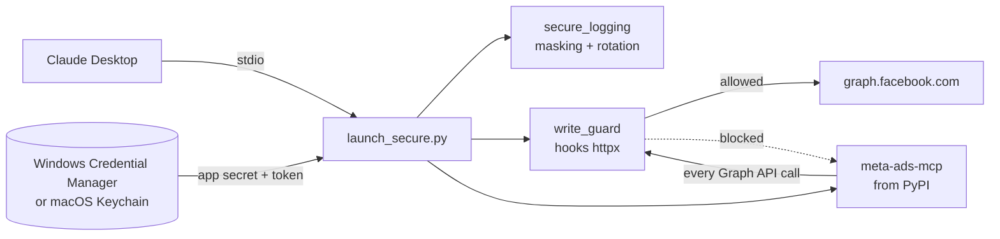
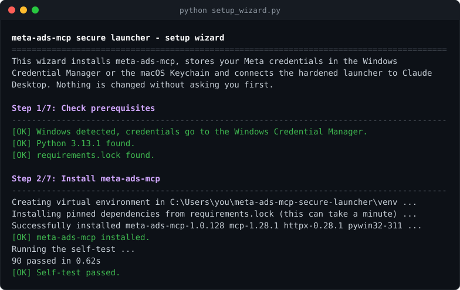
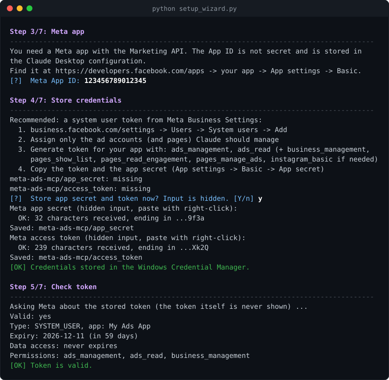
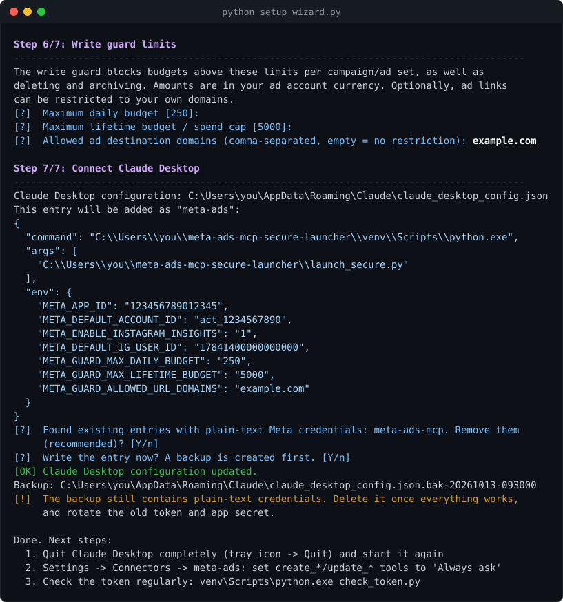

# meta-ads-mcp secure launcher

**English** · [Deutsch](README.de.md)

A hardened launcher for [`meta-ads-mcp`](https://github.com/pipeboard-co/meta-ads-mcp) on Windows and macOS. It lets Claude Desktop work with your Meta (Facebook/Instagram) ad accounts **without plain-text credentials in config files, without tokens in log files, and with a local safety net for write access**.

The launcher does not modify `meta-ads-mcp`. It installs the upstream package from PyPI, starts it through a small wrapper and adds the protections described below. A bilingual setup wizard (English/German) takes you through the setup step by step.

> [!NOTE]
> This is an independent community project. It is not affiliated with Meta, Pipeboard or Anthropic.

---

## Contents

- [Why?](#why)
- [Features](#features)
- [How it works](#how-it-works)
- [Requirements](#requirements)
- [Quick start with the setup wizard](#quick-start-with-the-setup-wizard)
- [Manual setup](#manual-setup)
- [Configuration reference](#configuration-reference)
- [Write guard](#write-guard)
- [Tool annotations](#tool-annotations)
- [Additional tools](#additional-tools)
- [Token check](#token-check)
- [Updating](#updating)
- [Troubleshooting](#troubleshooting)
- [Security model and limitations](#security-model-and-limitations)
- [Development](#development)
- [License](#license)

## Why?

The typical `meta-ads-mcp` setup puts `META_APP_SECRET` and `META_ACCESS_TOKEN` into `claude_desktop_config.json` in plain text. An audit of such a setup found more problems:

| Problem | Risk | Fixed by |
|---|---|---|
| App secret and access token in plain text in `claude_desktop_config.json` | Anyone who gets the file (backup, sync, support case, malware) controls your ad accounts | Credentials are stored in the **Windows Credential Manager** or the **macOS Keychain** |
| Older `meta-ads-mcp` versions (e.g. 1.0.97) wrote every Graph API URL **including `access_token=…`** into a debug log that is never rotated (11 MB in our case) | Token leaks via the log file | Secret masking, INFO level, **rotation 3 × 5 MB** (upstream fixed the leak itself in later versions, see GHSA-r3r9-3mrh-x966; the masking stays as defence in depth) |
| Full write access to campaigns, ad sets, ads and budgets, without limits | A misunderstood instruction or a prompt injection can raise budgets or delete campaigns | Local **write guard** that blocks deleting/archiving and budgets above your limits |
| A local OAuth callback server and a login-link tool are active, although token auth is used | Needless attack surface | Disabled by the launcher |
| Tokens with far more permissions than needed (posting on Instagram, reading messages, …) | Much larger blast radius if the token leaks | `check_token.py` reports unneeded permissions and the expiry date |
| Unpinned dependencies with known vulnerabilities (e.g. SSRF in `upload_ad_image` before 1.0.115, several in Pillow) | Exploitable via crafted images/URLs | `requirements.lock` with audited versions and a self-test |

## Features

- **No plain-text credentials** – app secret and token live in the Windows Credential Manager (DPAPI, bound to your Windows account) or in the macOS login keychain (encrypted with your login password). The Claude Desktop configuration only contains the non-secret App ID.
- **Hardened logging** – tokens and `appsecret_proof` are masked, debug output is suppressed, the log is UTF-8 and rotated (max. 3 × 5 MB).
- **Write guard** – blocks `DELETE`, the statuses `DELETED`/`ARCHIVED`, and budgets above configurable limits before the request leaves your machine. Claude receives a clear error message.
- **Destination allowlist** – optionally restricts ad links to your own domains, so a prompt injection cannot redirect your ads to someone else's site.
- **No data to Pipeboard** – requests to Pipeboard's servers are blocked unless you explicitly allow them.
- **Tool annotations** – all 41 upstream tools are marked as read-only, additive or destructive (MCP `readOnlyHint`/`destructiveHint`). Tools with large results declare `anthropic/maxResultSizeChars` for Claude Code.
- **Delivery status** – the extra tool `get_campaign_delivery` shows which campaigns really deliver, including campaigns that still say ACTIVE although they ended.
- **Default ad account** – optional; Claude then does not have to ask for the account ID in every chat.
- **Instagram Reels (opt-in)** – organic reach, views, likes, shares, saves and watch time of your Reels, plus public posts of other business accounts.
- **Token check** – shows validity, expiry and permissions without ever printing the token, and warns about upcoming expiry and unneeded permissions. Suitable as a scheduled task.
- **Setup wizard** – installs everything, stores the credentials with visible feedback (length and last 4 characters), checks the token and writes the Claude Desktop entry after asking, with a backup.
- **Bilingual** – the wizard and the helper scripts speak English and German.
- **Tested** – unit tests for all main modules, including one that verifies the launcher's log hardening works with the pinned upstream version.

## How it works



1. `launch_secure.py` configures logging **before** the package is imported, so the package cannot install its own unbounded handler.
2. It installs the write guard by wrapping `httpx.AsyncClient.send`, which every Graph API request of `meta-ads-mcp` passes through.
3. It reads the credentials from the Windows Credential Manager or the macOS Keychain (`credential_store.py`) into the process environment, disables the OAuth callback server and the login-link tool, and starts `meta-ads-mcp`.

## Requirements

- **Windows 10/11** (credentials in the Windows Credential Manager) or **macOS** (credentials in the Keychain)
- **Python 3.11 to 3.14** – [python.org](https://www.python.org/downloads/). On macOS also via Homebrew (`brew install python@3.13`). The `python3` from Apple's Command Line Tools (3.9) is too old, and for newer versions (3.15+) some pinned dependencies are not available yet. Check with `python3 --version`; if it does not fit, start the wizard with the version you installed, e.g. `python3.13 setup_wizard.py`.
- **Claude Desktop** – [claude.ai/download](https://claude.ai/download)
- A **Meta app** with the Marketing API and an **access token** for it, preferably from a system user

## Quick start with the setup wizard

Windows (PowerShell):

```powershell
git clone https://github.com/normannormalmann/meta-ads-mcp-secure-launcher.git
cd meta-ads-mcp-secure-launcher
python setup_wizard.py
```

macOS (Terminal):

```bash
git clone https://github.com/normannormalmann/meta-ads-mcp-secure-launcher.git
cd meta-ads-mcp-secure-launcher
python3 setup_wizard.py      # or python3.13 setup_wizard.py, see Requirements
```

The wizard asks for the language first (`--lang en` or `--lang de` skips the question). Every change needs your confirmation. The screenshots below come from a simulated run with placeholder data (`tools/render_screenshots.py`).

### 1. Prerequisites and installation

The wizard checks the operating system, the Python version and `requirements.lock`, creates a virtual environment in `venv`, installs the pinned dependencies and runs the self-test.



The screenshots show the Windows run. On macOS the wizard looks the same, but uses `venv/bin/python`, stores the credentials in the Keychain and writes to `~/Library/Application Support/Claude/claude_desktop_config.json`.

### 2. Meta app, credentials and token check

You enter the App ID (not secret). App secret and token are entered **hidden**. You still get feedback: number of characters and the last 4 characters, plus a format check. Then the wizard asks Meta whether the token is valid, when it expires and which permissions it has.



**Creating the token** (Meta Business Settings):

1. `business.facebook.com/settings` → *Users* → *System users* → *Add*
2. Assign only the ad accounts (and pages) that Claude should manage
3. *Generate token* for your app with `ads_management` and `ads_read`. Add `business_management`, `pages_show_list`, `pages_read_engagement`, `pages_manage_ads` and `instagram_basic` only if you create ads with pages or Instagram accounts.
4. Copy the token, and the app secret from the [app dashboard](https://developers.facebook.com/apps) (*App settings* → *Basic*)

> [!TIP]
> In the app dashboard under *App settings → Advanced*, enable **"Require App Secret"**. `meta-ads-mcp` sends `appsecret_proof` with every call, so a token stolen without the app secret becomes useless.

### 3. Write guard limits and Claude Desktop

You set the maximum daily and lifetime budget. The wizard shows the exact entry it will add, offers to remove old entries with plain-text credentials, creates a backup and writes the configuration.



**After the wizard:**

1. Quit Claude Desktop completely (Windows: tray icon → *Quit*, macOS: *Claude → Quit Claude* or `Cmd+Q`) and start it again.
2. In Claude Desktop under *Settings → Connectors → meta-ads*, set the `create_*` and `update_*` tools as well as `upload_ad_image` and `create_budget_schedule` to **"Always ask"**.
3. If your old configuration contained the Meta token and app secret in plain text: the wizard replaces the `meta-ads` entry, removes other entries with these credentials if you agree, and blanks them in the backup it writes (other entries stay unchanged). **Rotate the old token and app secret** anyway, since they were stored in plain text before.

## Manual setup

**Windows** (PowerShell):

```powershell
python -m venv venv
venv\Scripts\python.exe -m pip install -r requirements.lock
venv\Scripts\python.exe -m pytest -q          # self-test
venv\Scripts\python.exe store_secrets.py      # hidden input, stored in the Windows Credential Manager
$env:META_APP_ID = "123456789012345"
venv\Scripts\python.exe check_token.py
```

Then add this entry under `mcpServers` in `%APPDATA%\Claude\claude_desktop_config.json`. For the Microsoft Store version of Claude Desktop the file is under `%LOCALAPPDATA%\Packages\Claude_*\LocalCache\Roaming\Claude\`.

```json
"meta-ads": {
  "command": "C:\\path\\to\\meta-ads-mcp-secure-launcher\\venv\\Scripts\\python.exe",
  "args": ["C:\\path\\to\\meta-ads-mcp-secure-launcher\\launch_secure.py"],
  "env": {
    "META_APP_ID": "123456789012345",
    "META_GUARD_MAX_DAILY_BUDGET": "250",
    "META_GUARD_MAX_LIFETIME_BUDGET": "5000"
  }
}
```

**macOS** (Terminal):

```bash
python3.13 -m venv venv      # any Python 3.11-3.14
venv/bin/python -m pip install -r requirements.lock
venv/bin/python -m pytest -q                 # self-test
venv/bin/python store_secrets.py             # hidden input, stored in the macOS Keychain
export META_APP_ID=123456789012345
venv/bin/python check_token.py
```

The configuration file is `~/Library/Application Support/Claude/claude_desktop_config.json`:

```json
"meta-ads": {
  "command": "/Users/you/meta-ads-mcp-secure-launcher/venv/bin/python",
  "args": ["/Users/you/meta-ads-mcp-secure-launcher/launch_secure.py"],
  "env": {
    "META_APP_ID": "123456789012345",
    "META_GUARD_MAX_DAILY_BUDGET": "250",
    "META_GUARD_MAX_LIFETIME_BUDGET": "5000"
  }
}
```

Do **not** put `META_APP_SECRET` or `META_ACCESS_TOKEN` into this file.

## Configuration reference

| Variable | Where | Default | Meaning |
|---|---|---|---|
| `META_APP_ID` | Claude Desktop entry | – (required) | ID of your Meta app (not secret) |
| `META_GUARD_MAX_DAILY_BUDGET` | Claude Desktop entry | `250` | Maximum daily budget per object, in account currency |
| `META_GUARD_MAX_LIFETIME_BUDGET` | Claude Desktop entry | `5000` | Maximum lifetime budget / spend cap per object, in account currency |
| `META_DEFAULT_ACCOUNT_ID` | Claude Desktop entry | – | Default ad account (`act_…`), passed to Claude as server instructions and used by `get_campaign_delivery` |
| `META_ENABLE_INSTAGRAM_INSIGHTS` | Claude Desktop entry | off | `1` registers the Instagram Reels tools; `check_token.py` then treats `instagram_manage_insights` as needed |
| `META_DEFAULT_IG_USER_ID` | Claude Desktop entry | – | Default numeric Instagram user ID for the Reels tools |
| `META_GUARD_ALLOWED_URL_DOMAINS` | Claude Desktop entry | empty (rule off) | Comma-separated domains that ad links may point to, e.g. `example.com,shop.example.org` (subdomains included) |
| `META_GUARD_ALLOW_PIPEBOARD` | Claude Desktop entry | off | `1` allows requests to Pipeboard's servers |
| `META_MCP_LANG` | environment | system language | `de` or `en` for the wizard and the helper scripts |

Set automatically by the launcher: `META_ADS_DISABLE_CALLBACK_SERVER=1` and `META_ADS_DISABLE_LOGIN_LINK=1`.

The credentials are stored under the names `meta-ads-mcp/app_secret` and `meta-ads-mcp/access_token`:

- **Windows:** as *generic credentials*, visible under *Control Panel → Credential Manager → Windows Credentials*.
- **macOS:** as passwords in the login keychain (account `meta-ads-mcp`), visible in the *Keychain Access* app. The launcher and `store_secrets.py` access them with Apple's `/usr/bin/security` tool. The secret is passed on standard input, never as a command-line argument.

`store_secrets.py --status` shows whether they exist, without showing the values.

Log file: `%APPDATA%\meta-ads-mcp\meta_ads_debug.log` on Windows, `~/Library/Application Support/meta-ads-mcp/meta_ads_debug.log` on macOS (each + `.1` to `.3`; on macOS the folder is readable only by you). The log is capped at INFO by the launcher; `META_ADS_LOG_LEVEL=DEBUG` from upstream has no effect.

## Write guard

| Rule | Blocked when |
|---|---|
| Delete | HTTP `DELETE` to the Graph API |
| Status | `status` / `configured_status` = `DELETED` or `ARCHIVED` (pausing and activating are allowed) |
| Daily budget | `daily_budget`, `daily_spend_cap`, `daily_min_spend_target` above `META_GUARD_MAX_DAILY_BUDGET` |
| Lifetime budget | `lifetime_budget`, `spend_cap`, `lifetime_spend_cap`, `lifetime_min_spend_target` above `META_GUARD_MAX_LIFETIME_BUDGET` |
| Budget schedules | `ABSOLUTE` increases above the daily limit, `MULTIPLIER` above 2 |
| Unknown format | write requests whose body is not form-encoded or not valid UTF-8 (fail-closed) |
| Request smuggling | Graph paths other than `/vXX.X/segment/...` (letters, digits, `_`), the parameters `method`, `_method`, `batch`, `include_headers`, `suppress_http_code` in query or body, and any query parameter on POST except `access_token`/`appsecret_proof`. This stops tool arguments like `123?method=delete` from turning a harmless call into a different operation. |
| Destinations | only if `META_GUARD_ALLOWED_URL_DOMAINS` is set: a `link`, `website_url`, `template_url` or `deeplink_url` (also nested in `object_story_spec`/`asset_feed_spec`) that is not `https`, points outside the allowed domains or to an IP address, or contains user info. `display_url` and `url_tags` are not checked. Unparseable specs are blocked. |
| Pipeboard | any request to `mcp.pipeboard.co`, `meta-ads.mcp.pipeboard.co` or the host in `PIPEBOARD_API_BASE_URL`, unless `META_GUARD_ALLOW_PIPEBOARD=1` |

A blocked call never leaves your machine. Claude receives a Graph-style error (`Blocked by local write guard: …`), and the event is logged as a warning.

Budget and status rules check **every** value of a key (duplicates in query and body) and also keys nested in JSON fields such as `adset_budgets`. Amounts must be plain whole numbers.

**Limits:** the guard checks single requests. It does not enforce account-wide totals (many campaigns at the limit are still possible), and it does not limit `bid_amount`/`bid_cap`. Combine it with *"Always ask"* in Claude Desktop and, ideally, a spending limit on the ad account in Meta. Limits are interpreted as amount × 100 in the smallest currency unit, which is correct for EUR/USD but 100× more generous for currencies without minor units (e.g. JPY, KRW) – set lower values there.

The Pipeboard rule is defence in depth: the optional `duplicate_*` tools of `meta-ads-mcp` send campaign data to Pipeboard's servers. With Claude Desktop (stdio) they currently stop earlier, because they expect a Pipeboard token in an HTTP header. The rule makes sure the data stays local if that changes.

## Tool annotations

`meta-ads-mcp` does not tell clients which tools only read data. The launcher adds [MCP tool annotations](https://modelcontextprotocol.io/specification/2025-06-18/server/tools) to every tool (`tool_policy.py`):

| Category | Tools | Annotations |
|---|---|---|
| Read | `get_*`, `search_*`, `estimate_audience_size`, `compute_image_crops`, `generate_report` | `readOnlyHint` |
| Add | `create_ad`, `create_adset`, `create_campaign`, `create_ad_creative`, `upload_ad_image`, `duplicate_*` | not read-only, not destructive |
| Modify | `update_*`, `create_budget_schedule` | `destructiveHint` |
| Local file | `save_ad_image_locally` | not read-only, no network |
| Launcher | `get_campaign_delivery`, `get_instagram_*` (see below) | `readOnlyHint` |

A test fails as soon as an upstream update adds a tool that is not classified. At runtime, unknown tools are treated as destructive. `get_insights`, `get_ads`, `get_adsets` and `get_campaigns` also declare `anthropic/maxResultSizeChars` (500k/250k/150k/100k), which Claude Code uses to keep large results in the conversation. Whether Claude Desktop uses the annotations or this value is not documented. Setting tools to *"Always ask"* remains the reliable way.

## Additional tools

The launcher registers its own tools next to the upstream ones. They use a small Graph API client of their own (`graph_client.py`) and therefore pass the write guard as well.

### `get_campaign_delivery`

The Graph API has no field for the *Delivery* column in Ads Manager. `get_campaigns` therefore reports campaigns as `ACTIVE` that ended long ago ([upstream #34](https://github.com/pipeboard-co/meta-ads-mcp/issues/34), [#58](https://github.com/pipeboard-co/meta-ads-mcp/issues/58)). `get_campaign_delivery` combines `effective_status`, `start_time`/`stop_time` and the ad sets' `end_time`/`effective_status`:

| Delivery | Meaning |
|---|---|
| `ACTIVE` | Active and within its schedule (budget, billing and ad review are not checked) |
| `SCHEDULED` | Start time in the future |
| `COMPLETED` | Stop time passed, or all ad sets reached their end time |
| `NOT_DELIVERING` | No ad set is active, or the campaign has no ad sets |
| `PAUSED`, `WITH_ISSUES`, `IN_PROCESS`, `ARCHIVED`, `DELETED` | Taken over from `effective_status` |

Parameters: `account_id` (optional with a default account), `delivery_filter` (e.g. `ACTIVE`), `limit` (default 100, max 500). The answer contains counts per status and the campaigns with `delivery` and `delivery_reason`.

### Instagram Reels (opt-in)

With `META_ENABLE_INSTAGRAM_INSIGHTS=1` (the wizard asks for it), four read-only tools are added. They use the Instagram Graph API with Facebook Login on `graph.facebook.com`.

| Tool | Returns |
|---|---|
| `get_instagram_accounts` | Instagram Business/Creator accounts linked to your Facebook Pages, with their `ig_user_id` |
| `get_instagram_reels` | Your Reels, newest first (`limit` up to 100, optional `since` date) |
| `get_instagram_reel_insights` | `reach`, `views`, `likes`, `comments`, `shares`, `saved`, `total_interactions`, `ig_reels_avg_watch_time` (ms), `reposts` for one Reel |
| `get_instagram_public_media` | Recent public posts of **another** Business/Creator account via Business Discovery: likes, comments and views, optionally Reels only |

**Requirements:** an Instagram Business or Creator account linked to a Facebook Page, and a token with `instagram_basic`, `instagram_manage_insights`, `pages_read_engagement` and `pages_show_list` (plus `ads_read`/`ads_management` if the Page role comes from Business Manager, which is usual for system users).

**Limits (per Meta documentation):**

- Insight values are **organic only**. Interactions from ads are not counted. For paid results use `get_insights`.
- Data can be delayed up to 48 hours and is kept for up to 2 years. Media inside albums have no insights. Metrics without data are returned as `null`, not `0`.
- `views` and `total_interactions` are marked as "in development" by Meta, `reach` is estimated.
- Other accounts: only public posts of Business/Creator accounts via Business Discovery, **no insights**. Personal and age-restricted accounts are not available.

## Token check

```powershell
venv\Scripts\python.exe check_token.py --app-id 123456789012345   # or set META_APP_ID
# macOS: venv/bin/python check_token.py --app-id 123456789012345
```

The script prints validity, type, expiry, data-access expiry and permissions, never the token itself. Exit code `0` = OK, `1` = warnings (expires in under 14 days, invalid, unneeded permissions), `2` = error.

Weekly check as a scheduled task on Windows. The result appears as *Last Run Result* in the Task Scheduler. On macOS use a `launchd` LaunchAgent; it needs your unlocked login keychain, so it only works while you are logged in (`cron` usually cannot access the keychain).

```powershell
schtasks /Create /SC WEEKLY /D MON /ST 09:00 /TN "meta-ads token check" `
  /TR "\"C:\path\to\venv\Scripts\python.exe\" \"C:\path\to\check_token.py\" --app-id 123456789012345"
```

## Updating

`requirements.lock` pins a tested combination (currently `meta-ads-mcp` 1.0.128). To update:

```powershell
venv\Scripts\python.exe -m pip install --upgrade meta-ads-mcp
venv\Scripts\python.exe -m pytest -q
venv\Scripts\python.exe -m pip freeze --exclude-editable > requirements.lock
```

On macOS use `venv/bin/python` instead. `pip freeze` drops the platform marker of `pywin32` (Windows) or leaves `pywin32` out entirely (macOS): make sure `requirements.lock` contains `pywin32==311 ; sys_platform == "win32"` (with the current version), otherwise the installation fails on macOS or misses pywin32 on Windows.

Check the result with [`pip-audit`](https://pypi.org/project/pip-audit/) (`pip-audit -r requirements.lock`) and start the server once. The launcher relies on upstream internals (logger name, `httpx` usage). If the self-test fails after an update, go back with `pip install -r requirements.lock` from the previous commit.

## Troubleshooting

| Symptom | Fix |
|---|---|
| Claude Desktop shows the meta-ads server as failed | Run `venv\Scripts\python.exe launch_secure.py` (macOS: `venv/bin/python launch_secure.py`) in a terminal. Missing credentials or an invalid limit are reported on stderr. |
| `credentials missing in Windows Credential Manager` / `macOS Keychain` | Run `store_secrets.py` with the venv Python (`venv\Scripts\python.exe` or `venv/bin/python`) |
| macOS shows a keychain dialog (locked keychain, or items created by another tool) | Enter your login password and choose *Always Allow*. |
| `reading '…' from the keychain failed (security exit code …)` | Unlock the login keychain (log in again or open *Keychain Access*) and run `store_secrets.py --status`. |
| `Blocked by local write guard` | Intended. Make the change in Meta Ads Manager or raise the limit in the Claude Desktop entry. |
| The log file cannot be deleted (Windows) | An old server instance is still running. Quit Claude Desktop via the tray icon. |
| Token check: `Unneeded permissions` | Issue a new system user token with fewer permissions and run `store_secrets.py` again |
| Nothing visible while pasting | Normal for hidden input. After *Enter* you see the number of characters and the last 4 characters. |

## Security model and limitations

- **Protects against:** credentials in config files, backups and support uploads; tokens in log files; accidental or injected destructive write calls; ad links redirected to foreign domains (with the allowlist); campaign data sent to third-party servers; unnecessary local network services.
- **Does not protect against:** malware running under your user account. It can read the Credential Manager or the Keychain just like the launcher. It also does not protect against changes you approve yourself, or against everything the Meta permissions of the token allow outside of `meta-ads-mcp`.
- Any program running under your Windows account can read the credentials from the Credential Manager (there is no per-application protection). On macOS the keychain items allow access by `/usr/bin/security`, so any program running under your account can read them through that tool without a prompt. The launcher's protection is against files, backups and logs, not against local malware.
- The write guard is a safety net against mistakes and prompt injection, not a sandbox: it cannot judge whether an allowed change makes business sense. Keep *"Always ask"* enabled for write tools.
- The write guard works by wrapping `httpx`. A future upstream version that uses another HTTP client would bypass it. Pinned versions and the self-test exist for that reason.
- Windows and macOS only (no Linux).

Please report vulnerabilities privately, see [SECURITY.md](SECURITY.md).

## Development

```powershell
venv\Scripts\python.exe -m pytest -q
venv\Scripts\python.exe -m tools.render_screenshots   # regenerate docs/screenshots/*.svg
```

On macOS use `venv/bin/python`. The tests run on both systems; the Keychain and Credential Manager calls are replaced by test doubles.

| File | Purpose |
|---|---|
| `launch_secure.py` | Entry point for Claude Desktop |
| `credential_store.py` | Read/write credentials: Windows Credential Manager or macOS Keychain |
| `secure_logging.py` | Masking, log level, rotation |
| `write_guard.py` | Rules for write calls and blocked hosts |
| `url_policy.py` | Allowed ad destination domains |
| `form_fields.py` | Extracts all key/value pairs of a request (including duplicates and nested JSON) for the write guard |
| `tool_policy.py` | Tool annotations and result-size metadata |
| `extensions.py` | Launcher tools and default-account instructions |
| `delivery.py` | Delivery status logic |
| `graph_client.py` | Minimal Graph API client for launcher tools |
| `tool_output.py` | JSON and error output helpers for launcher tools |
| `settings.py` | Shared configuration values (default account, Instagram switches) |
| `instagram.py` | Instagram Reels tools (opt-in) |
| `store_secrets.py` | Store credentials (hidden input, `--status`) |
| `check_token.py` | Token validity, expiry, permissions |
| `setup_wizard.py` | Setup wizard (standard library only) |
| `i18n.py` | English/German messages |
| `tools/` | Screenshot rendering and test doubles |
| `tests/test_upstream_invariants.py` | Fails when an upstream update adds unclassified tools or HTTP clients other than `httpx` |

## License

[MIT](LICENSE) for the code in this repository.

`meta-ads-mcp` itself is **not** part of this repository. It is installed from PyPI and licensed by Pipeboard under the [Business Source License 1.1](https://github.com/pipeboard-co/meta-ads-mcp). This repository contains no code from `meta-ads-mcp`. The launcher only installs and starts it. When you install `meta-ads-mcp`, you accept its license yourself. Its *Additional Use Grant* permits production use, as long as you do not offer it to third parties as a hosted or embedded service that competes with the licensor's commercial offerings.
